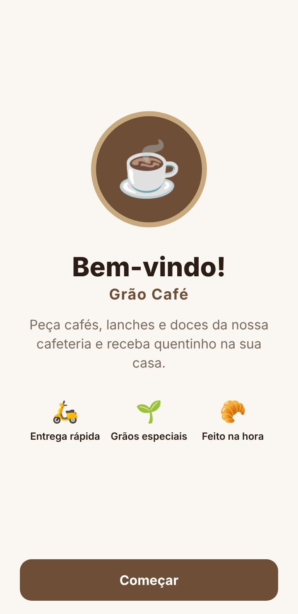
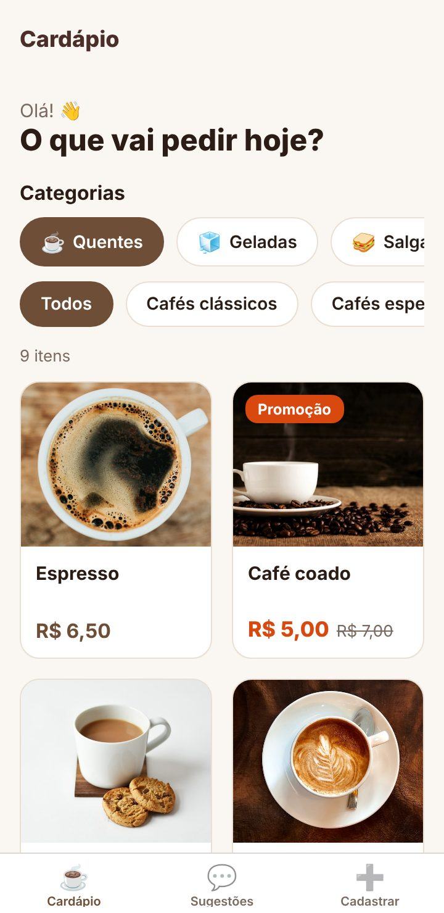
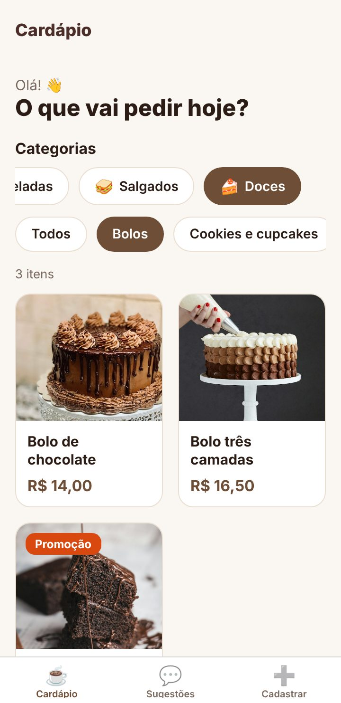
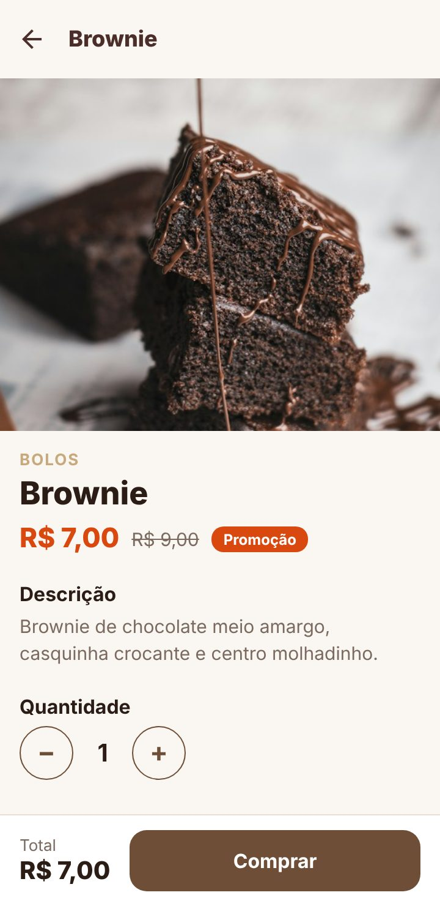
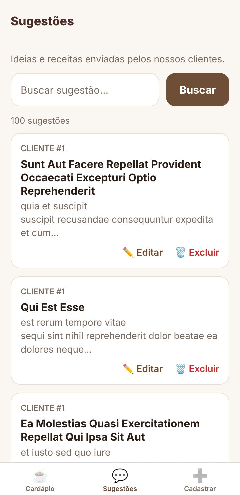
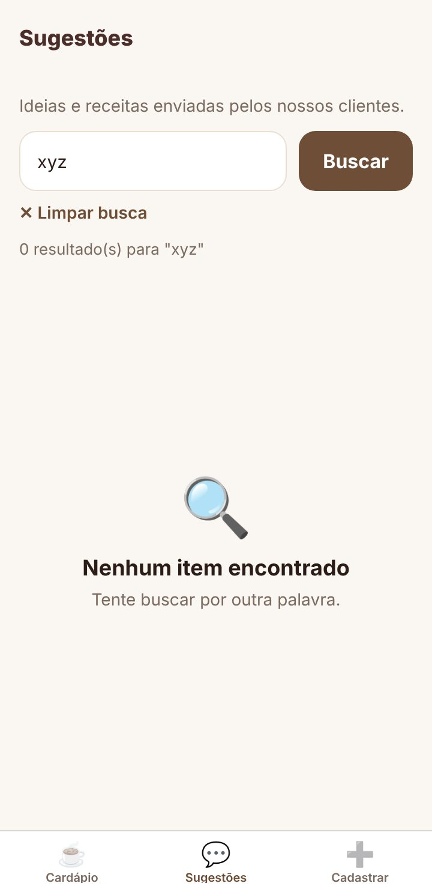
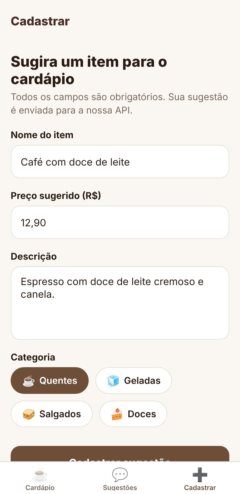
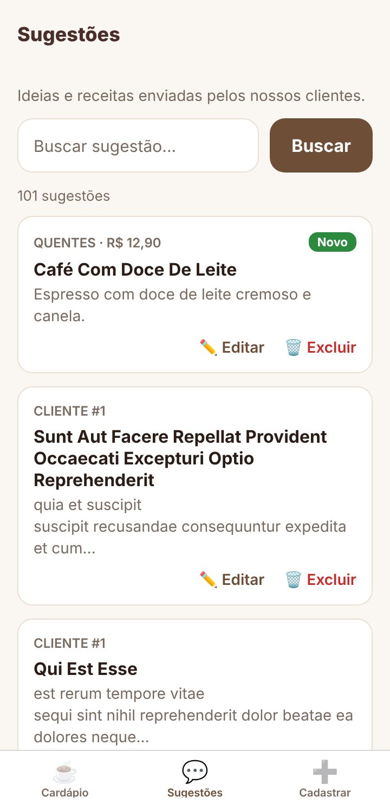
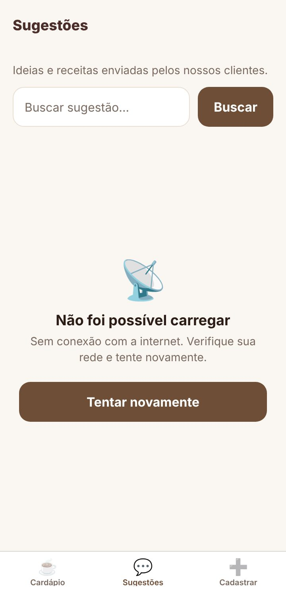

# ☕ Grão Café

Aplicativo mobile de **cafeteria / delivery** feito em **React Native + Expo** para a disciplina de
**Programação para Dispositivos Móveis**.

O usuário navega pelo cardápio (cafés, bebidas geladas, salgados e doces), filtra por categoria,
vê os detalhes de cada item e faz o pedido. O app também consome uma API pública com as
"sugestões dos clientes", onde é possível buscar, cadastrar, editar e excluir sugestões.

## 👤 Integrante

| Nome | RA |
| --- | --- |
| Pietro Pasqual Silva | 23183509-2 |

## ▶️ Como instalar e rodar

Pré-requisitos: [Node.js](https://nodejs.org/) (versão LTS) e o app **Expo Go** no celular
(Android ou iOS), ou um emulador.

```bash
# 1. Clonar o repositório
git clone https://github.com/PietroPasqual/mobile.git
cd mobile

# 2. Instalar as dependências
npm install

# 3. Iniciar o projeto
npx expo start
```

Depois disso:

- **Celular:** abra o Expo Go e escaneie o QR Code que aparece no terminal
  (celular e computador precisam estar na mesma rede Wi-Fi).
- **Emulador Android:** com o emulador aberto, aperte `a` no terminal.
- **Navegador:** aperte `w` no terminal.

> A tela de Sugestões usa a internet (API JSONPlaceholder). O cardápio funciona mesmo sem
> internet, mas as fotos dos produtos são carregadas online.

## 📱 Telas

| Boas-vindas | Home | Filtro de categorias |
| :---: | :---: | :---: |
|  |  |  |

| Detalhe do item | Lista da API | Busca sem resultado |
| :---: | :---: | :---: |
|  |  |  |

| Cadastro | Lista após cadastrar | Erro sem internet |
| :---: | :---: | :---: |
|  |  |  |

## ✅ Funcionalidades

**1. Boas-vindas / Onboarding**
- Logo em círculo, título "Bem-vindo!" e subtítulo explicando o app.
- Botão **Começar** fixo no rodapé, que leva para a Home.
- Conteúdo centralizado e com rolagem em telas pequenas.

**2. Home (cardápio)**
- Lista horizontal de categorias **macro**: Quentes, Geladas, Salgados e Doces.
- Ao tocar em uma macro, aparecem as categorias **micro** dela (ex.: Doces → Bolos, Cookies e
  cupcakes, Sobremesas), feitas com `filter()`.
- Grid de produtos em **2 colunas** (`FlatList` com `numColumns={2}`), com imagem, nome e preço.
- Itens em **promoção** com badge e preço em destaque (preço antigo riscado).
- Largura dos cards calculada pelo tamanho da tela (`useWindowDimensions`).

**3. Detalhe do item**
- Imagem no topo, categoria, nome, preço e descrição.
- Seletor de quantidade e total calculado.
- Botão **Comprar** sempre visível no rodapé, que mostra um `Alert` de item comprado.

**4. Lista da API (Sugestões)**
- Busca os dados de `https://jsonplaceholder.typicode.com/posts` com **axios** dentro de
  **useEffect** ao abrir a tela.
- `FlatList` com `keyExtractor`.
- `ActivityIndicator` enquanto carrega.
- Mensagem de erro amigável (sem internet, erro 404, erro 500) e botão **Tentar novamente**.
- Campo de busca + botão **Buscar**: não busca com o campo vazio e mostra
  "Nenhum item encontrado" quando não há resultado.

**5. Cadastro**
- Formulário com nome, preço, descrição e categoria.
- Validação de todos os campos (Alert quando algo está vazio ou o preço é inválido).
- Envio com `axios.post()`; o item novo aparece no topo da lista (selo "Novo").
- Formulário limpo após cadastrar e mensagem de sucesso ou erro.
- **Extra:** editar com `axios.put()` e excluir com `axios.delete()` com confirmação via Alert.

## 🗂️ Estrutura de pastas

```
├── App.js                      # Ponto de entrada: providers + navegação
└── src/
    ├── components/             # Componentes reutilizáveis (recebem dados por props)
    │   ├── CategoryItem.js     # Chip de categoria (Home e Cadastro)
    │   ├── CustomButton.js     # Botão padrão do app (com loading)
    │   ├── ProductCard.js      # Card do produto no grid
    │   ├── StatusMessage.js    # Mensagem de erro / lista vazia
    │   └── SuggestionCard.js   # Card de item da API
    ├── context/
    │   └── SugestoesContext.js # Lista da API compartilhada entre Sugestões e Cadastro
    ├── data/
    │   └── cardapio.js         # Dados fixos: categorias macro, micro e produtos
    ├── navigation/
    │   └── AppNavigator.js     # Stack (Onboarding → Abas → Detalhe) + Bottom Tabs
    ├── screens/
    │   ├── OnboardingScreen.js # Tela 1
    │   ├── HomeScreen.js       # Tela 2
    │   ├── DetailScreen.js     # Tela 3
    │   ├── SuggestionsScreen.js# Tela 4 (API)
    │   └── RegisterScreen.js   # Tela 5 (Cadastro)
    ├── services/
    │   └── api.js              # Instância do axios + mensagens de erro
    ├── theme/
    │   └── colors.js           # Cores e espaçamento padrão
    └── utils/
        └── formatarPreco.js    # 12.5 → "R$ 12,50"
```

## 🔎 Onde está cada requisito no código

| Requisito | Onde |
| --- | --- |
| `useEffect` que busca a API | `src/screens/SuggestionsScreen.js` → `carregarSugestoes()` chamado no `useEffect(..., [])` |
| Filtro macro → micro | `src/screens/HomeScreen.js` → `microsDaMacro` e `produtosFiltrados` |
| Grid de 2 colunas | `src/screens/HomeScreen.js` → `FlatList` com `numColumns={2}` |
| Flexbox em coluna | `OnboardingScreen.js` (`conteudo`), `StatusMessage.js` (`container`) |
| Flexbox em linha | `OnboardingScreen.js` (`destaques`), `DetailScreen.js` (`rodape`), `SuggestionsScreen.js` (`busca`) |
| `ActivityIndicator` | `SuggestionsScreen.js` (carregando) e `CustomButton.js` (enviando) |
| Tratamento de erro | `src/services/api.js` → `mensagemDeErro()` |
| POST / PUT / DELETE | `RegisterScreen.js` → `salvar()` e `SuggestionsScreen.js` → `excluir()` |
| `Alert` de compra | `DetailScreen.js` → `comprar()` |

## 🛠️ Tecnologias

- [Expo](https://expo.dev/) SDK 58 / React Native
- [React Navigation](https://reactnavigation.org/) (Native Stack + Bottom Tabs)
- [Axios](https://axios-http.com/)
- API pública [JSONPlaceholder](https://jsonplaceholder.typicode.com/)
- Fotos do cardápio: [Unsplash](https://unsplash.com/)

## 🎥 Vídeo

Link do vídeo de demonstração: _adicionar aqui_
